<div align="center">



<br/>

<a href="https://portfolio-rahul-10.vercel.app/"></a>
<a href="https://www.linkedin.com/in/tarachand-rahul-701a25291/"></a>
<a href="mailto:rahul.dev.xai@gmail.com"></a>
<a href="https://x.com/Rahul91204"></a>


</div>

<br/>

## About me

I am **Tarachand Rahul**, an **AI Engineer** and **Software Engineer**. I build AI systems and the software that carries them into production: the models and retrieval on one side, the APIs, data layer and deployment on the other.

At **Encraft AI** I build client-facing AI workflows that run video, image, document and structured data through LLMs and vision-language models, and I ship them on GCP and Azure.

```python
class Rahul:
    roles      = ["AI Engineer", "Software Engineer"]
    currently  = "AI Engineer @ Encraft AI"
    ai         = ["LLM agents", "RAG", "Speech and vision pipelines", "Explainable AI"]
    software   = ["Python", "FastAPI", "PostgreSQL", "React", "TypeScript", "Node.js"]
    deploys_on = ["Docker", "GitHub Actions", "GCP", "Azure"]
    open_to    = "AI Engineer and Software Engineer roles"
```

<br/>

<div align="center">

</div>

<br/>

## Technologies

<div align="center">

<br/>


<br/><br/>


</div>

<br/>

## GitHub in numbers

<div align="center">


<br/><br/>

<a href="mailto:rahul.dev.xai@gmail.com"></a>

</div>
